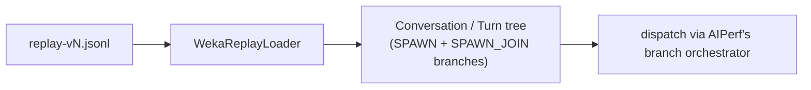

# Replaying Raw `wekai` Router Captures (`weka_replay`)

`weka_replay` is a native AIPerf loader for `replay-v3`/`v4`/`v5` captures — the raw JSONL format `wekai`'s router records directly from real agentic sessions, before any lossy conversion step. It sits alongside [`weka_trace`](weka-trace.md) as an independent, additive loader: nothing here changes `weka_trace` or the `inferencex-agentx-mvp` scenario.

## What a `replay-vN` capture is

A `replay-v3`/`v4`/`v5` file is a header line followed by one JSON object per **session** (optionally a trailing index on v5). Each session lists its **instances** (the main agent plus any sub-agents), and each instance carries an ordered list of **requests** with real absolute timestamps, exact server-reported token and cache counts, and real sampling parameters (`temperature`, `top_p`, `top_k`, `thinking`). Crucially, the capture also records explicit causal **spawn links** (`fan_out_group`/`fan_out_size`/`fan_out_position`) tying a sub-agent instance back to the exact parent request that spawned it — so the real, possibly multi-level, agent tree is recoverable directly from the file. What it does *not* record is message text: every content block is a hash, byte count, and an approximate token count, never the real string.

## How this differs from `weka_trace`

`weka_trace` consumes a separate, lossy intermediate format produced by a Go converter (`wekai router convert-aiperf-weka-trace`), which flattens multi-level sub-agent nesting to one level and discards real cache/token counts and sampling parameters in the process. `weka_replay` consumes the raw `replay-vN` capture directly, so it preserves the real multi-level tree (via AIPerf's generic SPAWN/SPAWN_JOIN branch mechanism — the same one `dag_jsonl` uses) and the real per-request token/cache/sampling data, instead of re-deriving approximations from a converted file.



## Generating input

Captures are produced by `wekai`'s router, a separate repository. Run `wekai router replay-prepare` against a recorded session to produce the `.jsonl` file this loader reads. See the `wekai` repo for the exact invocation and corpus layout.

## Basic usage

```bash
aiperf profile \
    --url localhost:8000 \
    --model Qwen/Qwen3-0.6B \
    --endpoint-type chat \
    --streaming \
    --input-file path/to/replay.jsonl \
    --custom-dataset-type weka_replay \
    --concurrency 8
```

Two things to always do:

- **Always pass a `.jsonl` file**, not a directory — `weka_replay` does not support directory input in v1 (constructing the loader with a directory `filename` raises immediately).
- **Always pass `--custom-dataset-type weka_replay` explicitly.** `can_load` matches broadly on the header's `_schema` field (`replay-v<N>`), and this schema key doesn't collide with any other registered loader's own `can_load` check (for example `mooncake_trace` looks for `input_length`/`text_input`/`messages`/`payload` at the top level, none of which a replay header has) — so auto-detection would not misroute a correctly-named `.jsonl` replay file to another loader. The real risk is the other direction: naming the file `.json` instead of `.jsonl`, or omitting the explicit flag, leaves the format ambiguous to a human reading your command even though the loader itself resolves it correctly. Pass the flag explicitly so the invocation is unambiguous and `load_dataset()`'s schema-version check (only `replay-v3`/`v4`/`v5` are accepted) fires with a clear error on a mismatched or corrupt file instead of silently falling through to a different loader.

A tokenizer and prompt corpus are required, same as any other trace loader — pass `--tokenizer` if your `--model` doesn't resolve a default one.

## What gets dropped by default

Two categories are dropped unless you opt in:

- **Orphan sessions** — captures with no resolvable `session_id` (roughly 5% of requests on the one real corpus measured). Opt in with `AIPERF_DATASET_WEKA_REPLAY_INCLUDE_ORPHANS=true`.
- **Ephemeral instances** — single-token liveness probes / CLI title-gen calls with no recorded system block. Opt in with `AIPERF_DATASET_WEKA_REPLAY_INCLUDE_EPHEMERAL=true`.

Any instance causally descended from a dropped instance is dropped too (cascading).

## Flag behavior

| Flag | Effect with `weka_replay` |
|---|---|
| `--custom-dataset-type weka_replay --input-file <path>` | Selects the loader. Required — no directory or inline-record input in v1. |
| `--num-dataset-entries N` | Caps the pool of sampled root conversations to the first `N` (highest priority of the three count flags). |
| `--num-conversations N` | Same effect when `--num-dataset-entries` isn't set. SPAWN children never count against this — it only bounds root sessions. |
| `--request-count N` | Third-priority fallback for pool size; also the literal wire-request stop condition, which (unlike session count) does count SPAWN children. |
| `--synthesis-max-isl N` | Drops individual requests whose recorded `input_tokens` exceeds `N`, applied during tree planning. A dropped request that was another instance's causal spawn point demotes that child to a non-causal top-level stream rather than dropping it outright — its data is still real, it just loses the one fact tying it to that parent turn. |
| `--synthesis-max-osl N` | Clamps `Turn.max_tokens` to at most `N`. |
| `--max-context-length N` | Drops a whole session whose peak single-request `(input_tokens + output_tokens)` — maxed across every conversation in its causal tree — exceeds `N`, mirroring `weka_trace`'s own peak-context semantics. (This flag is otherwise hard-rejected at config-build time for any non-`weka_trace`/non-`weka_hf` explicit custom format; `weka_replay` is explicitly allow-listed alongside `weka_trace`.) |
| `--isl-block-size N` | **Rejected at config-build time.** `weka_replay` has no block-tiling concept — content identity is per-block-hash, not fixed-size blocks — so this flag has nothing to apply to. Do not pass it with `weka_replay`. |
| `--prompt-corpus {sonnet,coding}` / `--tokenizer` | Fully generic — works automatically, same as any other trace-shaped loader. |
| `--cache-bust <target>` | Accepted under plain `concurrency` timing, but inert on the wire outside `agentic_replay` (marker minting only happens in the agentic-replay strategy). Only combine it with the `timing_mode: agentic_replay` YAML setup below if you want it to actually do something. |
| `--allow-dataset-wrap` | Generic, but the check it guards only runs under `agentic_replay`; plain concurrency mode never enforces a pool-size/concurrency relationship regardless of this flag. |
| `--fixed-schedule` | **Rejected.** The loader raises `NotImplementedError` if the resolved phase type is `FIXED_SCHEDULE` — `FixedScheduleStrategy` has no `is_root` filter and would double-dispatch every SPAWN child. Use `agentic_replay` (below) or plain concurrency mode instead. Auto-promotion to fixed-schedule is also inert for this format: it only fires when the first JSONL record has a top-level `timestamp` key, and a replay header has no such field. |

## Reaching `agentic_replay` without `--scenario`

`agentic_replay` is the recommended timing mode for real steady-state benchmarking with `weka_replay` (sampler-driven recycle, trajectory-based warmup). For `weka_trace`, `--scenario inferencex-agentx-mvp` is the only way to reach it. `weka_replay` isn't wired into that scenario, so the only route is setting `timing_mode: agentic_replay` directly on a phase in a YAML config — the YAML path doesn't re-check loader identity, so it isn't blocked the way `--scenario` is.

```yaml
# weka-replay-agentic.yaml
schemaVersion: "2.0"

benchmark:
  model: Qwen/Qwen3-0.6B
  endpoint:
    url: http://localhost:8000
    type: chat
    streaming: true
  dataset:
    type: file
    format: weka_replay
    path: path/to/replay.jsonl
  phases:
    - name: profiling
      type: concurrency
      concurrency: 50
      timing_mode: agentic_replay
      duration: 900
```

```bash
aiperf profile --config weka-replay-agentic.yaml
```

**This combination is newer and less-tested than `weka_trace` + `--scenario inferencex-agentx-mvp`.** The `agentic_replay` scheduler itself has a known limitation that matters more here than for a single-level trace — see below.

## Known limitation: depth-1 engine seeding

`weka_replay` preserves the real tree at any depth — a sub-agent can itself spawn a sub-sub-agent, and so on. The `agentic_replay` snapshot/overlap-dispatch logic (`TrajectorySource`'s warmup seeding and `BranchOrchestrator`'s overlap dispatch), however, only walks one level of `branches` (depth 0 → 1). If a sampled warmup snapshot point falls mid-flight inside a depth-2-or-deeper instance, that instance won't be correctly seeded under `agentic_replay`.

This is an engine-side limitation, not a bug in this loader — fixing it is out of scope here. The loader logs an `agent_depth` histogram on every load so you can see how much of your corpus goes past depth 1 before deciding whether `agentic_replay` is a good fit for a given capture, or whether plain concurrency mode (which has no snapshot/seeding step) is the safer choice.

## The five env knobs

| Env var | Default | Effect |
|---|---|---|
| `AIPERF_DATASET_WEKA_REPLAY_SESSION_MODE` | `tree` | `tree` builds the causal/co-session tree rooted at the session's main conversation (spawn/co-session children as SPAWN branches). `independent` instead emits every non-causal stream of the session as its own top-level conversation, with no cross-conversation SPAWN linkage. |
| `AIPERF_DATASET_WEKA_REPLAY_INCLUDE_ORPHANS` | `false` | Include sessions with no resolvable session id instead of dropping them. |
| `AIPERF_DATASET_WEKA_REPLAY_INCLUDE_EPHEMERAL` | `false` | Include instances with no recorded system block (liveness probes / title-gen) instead of dropping them (and their descendants). |
| `AIPERF_DATASET_WEKA_REPLAY_INCLUDE_ROLES` | `` (empty = all) | Comma-separated allow-list of roles (e.g. `main,sub-agent`) an instance must match to be retained. |
| `AIPERF_DATASET_WEKA_REPLAY_SAMPLING_PASSTHROUGH` | `temperature,top_p` | Comma-separated list of recorded sampling parameters carried into each request's `extra_body` verbatim. `top_k`/`thinking` are opt-in since some OpenAI-compatible servers reject unknown fields. |

## Related tutorials

- [Replaying Agentic Coding Sessions with Weka Traces](weka-trace.md) — the converted-intermediate-format sibling loader.
- [DAG Benchmarking (Sub-Agents)](../benchmark-modes/dag.md) — the SPAWN/SPAWN_JOIN mechanism this loader builds on.
- [YAML Configuration Files](yaml-config.md) — background on the config shape used above.
