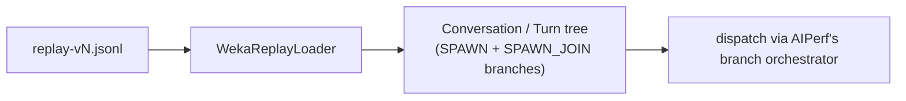

# Replaying Raw `wekai` Router Captures (`weka_replay`)

`weka_replay` is a native AIPerf loader for `replay-v3`/`v4`/`v5` captures — the raw JSONL format `wekai`'s router records directly from real agentic sessions, before any lossy conversion step. It sits alongside [`weka_trace`](weka-trace.md) as an independent, additive loader: nothing here changes `weka_trace` or the `inferencex-agentx-mvp` scenario.

## What a `replay-vN` capture is

A `replay-v3`/`v4`/`v5` file is a header line followed by one JSON object per **session** (optionally a trailing index on v5). Each session lists its **instances** (the main agent plus any sub-agents), and each instance carries an ordered list of **requests** with real absolute timestamps, exact server-reported token and cache counts, and real sampling parameters (`temperature`, `top_p`, `top_k`, `thinking`). What it does *not* record is message text: every content block is a hash, byte count, and an approximate token count, never the real string.

Sub-agent spawns are recorded via `parent_spawn_request_id` (the request that spawned this instance) plus `fan_out_group` (that same id, as a string — a sanity cross-check rather than a second source of truth) and `fan_out_position` (sibling order within a fan-out). A link only counts as a real, structure-building spawn when the parent request genuinely belongs to another instance in the same session and the child didn't start before it; anything else (a dangling/self-referential/time-inverted link, or a spawn-group marker with no parent id at all) is demoted to a non-causal stream instead of asserted as a spawn — see [Tree shape](#tree-shape) below.

## How this differs from `weka_trace`

`weka_trace` consumes a separate, lossy intermediate format produced by a Go converter (`wekai router convert-aiperf-weka-trace`), which flattens multi-level sub-agent nesting to one level and discards real cache/token counts and sampling parameters in the process. `weka_replay` consumes the raw `replay-vN` capture directly, so it preserves the real multi-level tree (via AIPerf's generic SPAWN/SPAWN_JOIN branch mechanism — the same one `dag_jsonl` uses) and the real per-request token/cache/sampling data, instead of re-deriving approximations from a converted file.



## Generating input

Captures are produced by `wekai`'s router, a separate repository. Run `wekai router replay-prepare` against a recorded session to produce the `.jsonl` file this loader reads. See the `wekai` repo for the exact invocation and corpus layout.

## Basic usage

```bash
aiperf profile \
    --url localhost:8000 \
    --model Qwen/Qwen3-0.6B \
    --endpoint-type chat \
    --streaming \
    --input-file path/to/replay.jsonl \
    --custom-dataset-type weka_replay \
    --concurrency 8 \
    --num-dataset-entries 200
```

**Always pass `--num-dataset-entries` (or another count flag) explicitly.** Without any stop condition AIPerf defaults to 10 requests total — but this loader still has to parse and plan every session in the file to build its sampling pool first, since `convert_to_conversations` runs session-by-session rather than stopping early. On a multi-GB corpus that means a full-corpus parse to serve ten requests. `--num-dataset-entries N` caps the pool *before* any session is parsed (see the flag table below), so set it to something in the ballpark of what you actually intend to sample from.

Two things to always do:

- **Always pass a `.jsonl` file**, not a directory — `weka_replay` does not support directory or inline-record input in v1 (constructing the loader with a directory `filename`, or passing `--inline-records`, raises immediately).
- **Always pass `--custom-dataset-type weka_replay` explicitly**, even though `can_load`'s broad match on the header's `_schema` field (`^replay-v\d+$`) means auto-detection also resolves it correctly today (verified: no other registered loader's own `can_load` matches a replay header). Passing the flag keeps the invocation unambiguous to a human reader and makes `load_dataset()`'s schema-version check (only `replay-v3`/`v4`/`v5` are accepted) the thing that fires on a corrupt or mismatched file, rather than leaving format resolution implicit.

A tokenizer and prompt corpus are required, same as any other trace loader (the default prompt corpus is `coding`) — pass `--tokenizer`/`--prompt-corpus` if your `--model` doesn't resolve a default one.

## What gets dropped by default

Three categories are dropped unless you opt in or they're structurally unavoidable:

- **Orphan sessions** — captures with no resolvable `session_id` (a session whose id is exactly `orphan:no-session-id`, the shared cross-user bucket, or starts with `orphan:no-session-id:`, a per-record shape). Opt in with `AIPERF_DATASET_WEKA_REPLAY_INCLUDE_ORPHANS=true`. Opting in always forces the shared bucket specifically into `independent` session mode regardless of `AIPERF_DATASET_WEKA_REPLAY_SESSION_MODE` — its implicit parent links are chronological proximity across unrelated users, not real structure, so it's never safe to tree-anchor.
- **Ephemeral instances** — instances the producer itself recorded with role `"ephemeral (no system)"` (single-token liveness probes / CLI title-gen calls; the loader trusts this recorded role rather than inspecting system blocks itself). Opt in with `AIPERF_DATASET_WEKA_REPLAY_INCLUDE_EPHEMERAL=true`.
- **Instances with zero requests** — a structural necessity, not a policy choice; there's no way to build a conversation turn from nothing. Always dropped, no opt-out.

Any instance causally descended from a dropped instance cascades out too — but only along *verified causal* links. This cascade applies to ephemeral drops and to `AIPERF_DATASET_WEKA_REPLAY_INCLUDE_ROLES` drops; it does **not** apply to `--synthesis-max-isl` drops (an over-length request's causal child is demoted to a non-causal stream instead, keeping its data) or to zero-request instances (their own causal children simply lose a confirmable parent and become non-causal).

One more block is dropped on every single request, not just some instances — see [Diagnostics and fidelity](#diagnostics-and-fidelity)'s billing-header note below.

## Flag behavior

| Flag | Effect with `weka_replay` |
|---|---|
| `--custom-dataset-type weka_replay --input-file <path>` | Selects the loader. No directory or inline-record input in v1. "Required" is advisory — broad `_schema` matching means auto-detection would also resolve it — but always pass it explicitly (see above). |
| `--num-dataset-entries N` | Caps the pool to the first `N` *sessions* (not already-filtered root conversations) before any of them is parsed — highest priority of the three count flags. In `independent` session mode, or for the included shared orphan bucket, one session can still produce several root conversations, so the final sampled-root count isn't a direct 1:1 with `N`. Filtering (orphan/ephemeral/role/`--synthesis-max-isl`/`--max-context-length`) runs *after* this cap, so the final count can end up below `N` — the opposite order from `weka_trace`, which must fully parse before it can filter-then-cap. On v5 with a usable trailing index, "first N" means index order (ascending `start_ts`); it's file order only on v3/v4 or when the index falls back to a full scan. |
| `--num-conversations N` | Same effect as `--num-dataset-entries` when that flag isn't set (second priority); also sets the phase's session-count stop condition. Only root conversations are sampled and count against it — SPAWN children never do, matching `dag_jsonl`'s own session-counting semantics. Same per-session (not per-root) caveat as above. |
| `--request-count N` | Third-priority fallback for pool size; also the literal wire-request stop condition, which (unlike session count) **does** count SPAWN children. |
| `--synthesis-max-isl N` | Drops individual requests whose recorded `input_tokens` exceeds `N`, applied during tree planning (there's no per-request counter for this — only `dropped_for_max_isl_count`, instances left fully empty by the filter, and `causal_parent_dropped_by_max_isl_count`, children demoted). A dropped request that was another instance's causal spawn point demotes that child rather than dropping it outright: in `tree` session mode it's re-attached as a background co-session branch on the primary root (depth 1, no join); in `independent` mode it simply becomes its own root. An instance left with zero requests is dropped (not cascaded further). Because the removed request is simply absent from its instance's remaining sequence, the next kept request's delay spans the gap, and its wire usually stops being a clean extension of the previous one — expect `reset_context=True` on that turn. |
| `--synthesis-max-osl N` | Clamps every turn's `max_tokens` to `max(1, min(recorded_output_tokens, N))`, at every depth — note this comes from the recorded `output_tokens`, not the recorded `max_tokens` field. |
| `--max-context-length N` | Drops a whole session whose peak single-request `(input_tokens + output_tokens)` — maxed across every root, causal child, and co-session stream in its tree — exceeds `N`, mirroring `weka_trace`'s own peak-context semantics; runs after the `--synthesis-max-isl` filter and the entries cap. (This flag is otherwise hard-rejected at config-build time for an explicit custom format outside `{weka_trace, weka_replay}`; `weka_replay` is allow-listed alongside `weka_trace`.) |
| `--isl-block-size N` | Rejected with an explicit `--custom-dataset-type weka_replay` (`weka_replay` has no block-tiling concept — content identity is per-block-hash, not fixed-size blocks). Note the rejection message is generic, not weka_replay-specific. **With auto-detected format, or set via YAML `block_size:`, it is silently ignored instead of rejected** — don't rely on either path to catch a stray `--isl-block-size`; omit the flag entirely with this loader. |
| `--prompt-corpus {sonnet,coding}` / `--tokenizer` | Fully generic — works automatically, same as any other trace-shaped loader. Default corpus is `coding`. |
| `--cache-bust <target>` | Accepted under plain `concurrency` timing, but inert on the wire outside `agentic_replay` (marker minting only happens in the agentic-replay strategy, and needs a chat/responses endpoint). Only combine it with the `timing_mode: agentic_replay` YAML setup below if you want it to actually do something. |
| `--allow-dataset-wrap` | Generic, but the check it guards only runs under `agentic_replay`; plain concurrency mode never enforces a pool-size/concurrency relationship regardless of this flag. |
| `--fixed-schedule` | Rejected — the loader raises `NotImplementedError` at construction if the resolved phase type is `FIXED_SCHEDULE` (`FixedScheduleStrategy` has no `is_root` filter and would double-dispatch every SPAWN child). Use `agentic_replay` (below) or plain concurrency mode instead. Auto-promotion to fixed-schedule is also inert for this format: it only fires when the first JSONL record has a top-level `timestamp` key, and a replay header has none. **This guard only runs when the loader is actually constructed** — see the dataset-cache note under [Diagnostics and fidelity](#diagnostics-and-fidelity). |
| `--ignore-trace-delays` | Strips all simulated timing: every turn's `timestamp`, `delay`, and `api_time_ms` become `None`. Overlap-aware dispatch and timestamped-trajectory sampling have nothing to key off at that point. |
| `--inter-turn-delay-cap-seconds N` | Clamps every computed inter-turn delay to at most `N` seconds (via the shared `DelayCapTracker`). Recorded real idle gaps can be minutes long; set this if you don't want the benchmark's wall-clock pacing to include them. |
| `--use-think-time-only` | Silently has no effect on `weka_replay` — this loader's delay is already an end-to-start idle gap (see [Timing simulation](#timing-simulation)), so there's no separate "think time only" mode to switch into. |

## Reaching `agentic_replay` without `--scenario`

`agentic_replay` is the recommended timing mode for real steady-state benchmarking with `weka_replay` (sampler-driven recycle, trajectory-based warmup). `weka_replay` isn't wired into `--scenario inferencex-agentx-mvp` (its loader allow-list only covers `weka_trace`/`weka_hf` and the `semianalysis_*` aliases) — but the same YAML `timing_mode: agentic_replay` route that reaches it for `weka_replay` also works for `weka_trace`; `--scenario` is simply the more common path for that loader, not the only one.

```yaml
# weka-replay-agentic.yaml
schemaVersion: "2.0"

benchmark:
  model: Qwen/Qwen3-0.6B
  endpoint:
    url: http://localhost:8000
    type: chat
    streaming: true
  dataset:
    type: file
    format: weka_replay
    path: path/to/replay.jsonl
  phases:
    - name: profiling
      type: concurrency
      concurrency: 50
      timing_mode: agentic_replay
      duration: 900
```

```bash
aiperf profile --config weka-replay-agentic.yaml
```

**This combination is newer and less-tested than `weka_trace` + `--scenario inferencex-agentx-mvp`.** The `agentic_replay` scheduler itself has a known limitation that matters more here than for a single-level trace — see below.

## Known limitation: depth-1 engine seeding

`weka_replay` preserves the real tree at any depth — a sub-agent can itself spawn a sub-sub-agent, and so on. The `agentic_replay` snapshot/overlap-dispatch logic (`TrajectorySource`'s warmup seeding and `BranchOrchestrator`'s overlap dispatch), however, only walks one level of `branches` (depth 0 → 1). If a sampled warmup snapshot point falls mid-flight inside a depth-2-or-deeper instance, that instance won't be correctly seeded under `agentic_replay`.

Note that in `tree` session mode, every co-session stream (another `main`-role instance in the same session, a helper, or a demoted/non-causal link) is itself placed at `agent_depth=1` as a background branch on the primary root — so a *real* sub-agent spawned off one of those streams lands at depth 2 purely because of co-session anchoring, not because it's deeply nested relative to the user's actual conversation. The loader logs an `agent_depth` histogram on every load (on a dataset-cache miss — see below) so you can see how much of your corpus goes past depth 1 before deciding whether `agentic_replay` is a good fit, keeping in mind the histogram mixes both effects.

This is an engine-side limitation, not a bug in this loader — fixing it is out of scope here.

## Tree shape

- **Root selection** (`tree` session mode): the earliest non-causal instance with role `main` becomes the session's one primary root. Every *other* non-causal stream in the session (another `main`, a helper, a demoted/anomalous link) is attached to it as a background co-session SPAWN branch — no join, `agent_depth=1`, anchored at the last root turn that started at or before that stream's own first request.
- **Causal children**: a genuinely spawned sub-agent (verified `fan_out_group`/`parent_spawn_request_id` link) attaches to its real parent turn as a SPAWN branch regardless of session mode. It's classified **synchronous** (gated by a `SPAWN_JOIN` on the parent's very next turn) when its last request ends at or before the parent's next request starts (within 1ms); otherwise it's **asynchronous** (a background branch with no join) — this includes every spawn off a parent's *last* turn, since there's no next turn to gate.
- **Branch IDs** follow `"<instance_id>:<turn>:spawn"` (sync), `"...:spawn_bg"` (async causal), or `"...:cosession"` (co-session anchoring). A conversation's own id is always its `instance_id` verbatim.
- **`independent` session mode** changes only how *non-causal* streams relate to each other (each becomes its own top-level root instead of being anchored under one primary root) — it never disables real SPAWN linkage for a verified causal child.

## Timing simulation

Inter-turn delay is an end-to-start idle gap: `delay = max(0, ts_k − (ts_{k−1} + total_ms_{k−1}))`, clamped through `--inter-turn-delay-cap-seconds` if set. On `replay-v3` (no recorded request durations) or any request with `total_ms <= 0`, this degrades to the raw start-to-start gap — which includes the previous request's own processing time as if it were idle — and the loader logs a one-time warning the first time this happens. A child branch's own start offset is derived the same way (gap from its spawning parent's response, or from the earliest sibling's start if durations aren't known), and is honored by the engine as a real scheduling wait whether or not `agentic_replay` is in use — plain concurrency mode dispatches a child exactly when its parent's declaring turn returns, with `agentic_replay` additionally using these offsets for overlap dispatch and snapshot sampling.

On `replay-v4`/`v5` input, the capture also carries its own precomputed `think_ms`/`think_ref` per request (the same gap, measured by the producer itself, relative to either the previous request on the same instance, the spawning parent, or — only for a root instance with no parent — the session's own start). This loader never uses `think_ms` to drive behavior (replaying "the session started 3 hours before the first message" as a literal startup pause would be wrong for a compressed benchmark run), but it does cross-check its own derived delay/branch-start values against the capture's recorded `think_ms` wherever a reference lines up (`"prev"` and `"spawn"`, never `"session_start"`), purely for validation. A disagreement is counted — not corrected — when the two differ by more than 500ms or 10% of the recorded value, whichever is larger; see the diagnostics counters below.

## Content synthesis essentials

Real message text is never recorded, so every content block is synthesized from a shared pre-tokenized corpus, in 256-token chunks seeded by session id and the block's content-identity anchor — the same anchor always decodes to the same text within a session, but content identity (and so the synthesized text) is **not** shared across sessions. Tool definitions are folded into the leading system message as text rather than sent as structured `raw_tools` (`raw_tools` is always `None` for this loader). Context mode is `DELTAS_WITH_RESPONSES`: the capture's own recorded assistant turns are replayed as history, and whatever the live server actually responds with is discarded for context purposes. A turn whose resolved content strictly extends the previous turn on its instance sends only the new delta; anything else (a real divergence, or turn 0) resends the full current wire with `reset_context=True`.

Recorded model names are mapped onto your `--model`/configured model list by first-appearance order across the whole load, wrapping round-robin if the capture has more distinct models than you configured — so a real Claude model name never reaches your vLLM/sglang endpoint.

## Diagnostics and fidelity

Every load ends with two summary log lines (and the per-session `SessionDiagnostics` counters below feed the first one's `diagnostics: {...}` dict):

- **`weka_replay: loaded K/S session(s)...`** — `S` counts every session the span scan found, including ones skipped for being orphan-shaped, but *not* ones cut by `--num-dataset-entries`'s span-level cap. The `diagnostics` dict sums counters like `dropped_instance_count` (zero-request instances), `cycle_broken_count`/`anomalous_count` (spawn-shaped links the producer itself couldn't verify, demoted to non-causal), `ephemeral_dropped_count`/`role_filtered_dropped_count`/`cascade_dropped_count`, `dropped_for_max_isl_count`/`causal_parent_dropped_by_max_isl_count`, `orphan_session_dropped`/`empty_session_after_filtering`/`dropped_for_max_context_length`, `root_fallback_used_count` (a tree-mode session with no non-causal `main`, so the earliest stream became root anyway), `billing_header_dropped_count` (see below), and `think_prev_compared_count`/`think_prev_disagreement_count`/`think_spawn_compared_count`/`think_spawn_disagreement_count` (see [Timing simulation](#timing-simulation)). It also reports the session's **theoretical prefix-cache-hit tokens vs. the capture's own recorded `cache_read_tokens`**.
- **`weka_replay content-identity: ...`** — resolution counts (`slot_same_hash`/`exact_hash`/`seed_hash`/`churn`/`minted`) and a minted-block percentage: a high minted percentage means poor content reuse and a low theoretical cache-hit number. The flip-byte-delta histogram is a validation aid for the `cache_control`-churn heuristic — a delta that isn't a multiple of the three known fragment sizes points at a `cache_control` shape the heuristic doesn't yet recognize.

**The theoretical prefix-cache-hit metric**, stamped onto every `Turn` and surfaced on the console as "Theoretical Prefix Cache Hit (%)": for each turn, in the session's chronological order across every instance, it finds the longest common prefix between that turn's resolved content-id sequence and any earlier turn's in the same session, converts to 64-token blocks, and reports hit/total. This is a *reconstruction*, not a replay of the real server's cache behavior, and can legitimately read both lower and higher than the capture's own recorded `cache_read_tokens`:

- **Lower**, because content identity is scoped *per session* (the synthesized text's own seed includes the session id), so a system prompt or tool spec genuinely shared across two different captured sessions never counts as a hit here even though the real traffic's cache would have seen it; because of the 64-token floor per request; and because of any genuine content-identity miss (a block minted as new that was really a repeat).
- **Higher**, because it assumes an infinite, TTL-free cache and credits any matching prefix rather than only the positions Anthropic's real `cache_control` breakpoints mark as cacheable, and because ordering turns purely by their recorded start time lets a turn "hit" against a wire that was technically still in flight in the original capture.

One real, confirmed fix this fidelity depends on: every request's `system_blocks[0]` is dropped whenever it's under 200 bytes (mirrors `wekai`'s own `effectiveSystemBlocks`) — this is the capture's own per-request billing/preamble header, which carries a near-unique hash on essentially every request and, left in, mints a fresh content id at the very start of the wire on nearly every turn, breaking prefix matching for everything after it. The drop is size-only (no hash/`cache_control` check), so a genuinely short first system block on some instance is dropped too; it's counted per request in `billing_header_dropped_count`, and its own token share gets folded into whatever's minted elsewhere in that same request (so very small, request-level ISL drift against the recorded `input_tokens` is expected and shows up in `input_tokens_mismatch_count`).

**The dataset mmap cache can mask all of the above.** `AIPERF_DATASET_MMAP_CACHE_ENABLED` defaults on; a cache hit (same input file, custom-dataset-type, tokenizer, and relevant settings as a previous run) skips the tokenizer **and the composer** entirely — which means none of this loader's own load-time logs (histogram, diagnostics, cache-hit-vs-recorded, content-identity line) run, and the `--fixed-schedule` guard above (which only fires when the loader itself is constructed) doesn't either. If you're debugging fidelity numbers, or switching between `--fixed-schedule` and a different phase type against the same input file, clear or disable the cache (`AIPERF_DATASET_MMAP_CACHE_ENABLED=false`, or clear `~/.cache/aiperf/dataset_mmap`) first so you're looking at — and gated by — the current run.

## The five env knobs

| Env var | Default | Effect |
|---|---|---|
| `AIPERF_DATASET_WEKA_REPLAY_SESSION_MODE` | `tree` | `tree` anchors every non-causal stream except the primary root as a background co-session branch under it. `independent` instead makes every non-causal stream its own top-level root — but either way, a verified causal sub-agent still attaches to its real spawning parent as a SPAWN branch; this only changes how non-causal streams relate to each other. See [Tree shape](#tree-shape). |
| `AIPERF_DATASET_WEKA_REPLAY_INCLUDE_ORPHANS` | `false` | Include sessions with no resolvable session id instead of dropping them (forces the shared orphan bucket into `independent` mode — see [What gets dropped by default](#what-gets-dropped-by-default)). |
| `AIPERF_DATASET_WEKA_REPLAY_INCLUDE_EPHEMERAL` | `false` | Include instances the producer recorded with role `"ephemeral (no system)"` instead of dropping them (and their causal descendants). |
| `AIPERF_DATASET_WEKA_REPLAY_INCLUDE_ROLES` | `` (empty = all) | Comma-separated allow-list of roles (`main`, `sub-agent`, `helper-or-isolated`, `orphan-sub-agent`, `ephemeral (no system)`, `unknown`) an instance must match to be retained; an unrecognized name is warned about and ignored. If every name you list is unrecognized, the effective allow-list is empty and every instance is dropped — check the load's warning log if a run unexpectedly yields nothing. Note an ephemeral instance is still dropped unless `INCLUDE_EPHEMERAL=true` is *also* set, even if its role is listed here. |
| `AIPERF_DATASET_WEKA_REPLAY_SAMPLING_PASSTHROUGH` | `temperature,top_p` | Comma-separated list of recorded sampling parameters carried into each request's `extra_body` verbatim. `top_k`/`thinking` are opt-in since some OpenAI-compatible servers reject unknown fields. An unrecognized name is silently ignored; an empty value passes nothing through. |

All five are part of the dataset mmap cache's key, so changing one correctly invalidates a previously cached dataset for the same input file.

## Related tutorials

- [Replaying Agentic Coding Sessions with Weka Traces](weka-trace.md) — the converted-intermediate-format sibling loader.
- [DAG Benchmarking (Sub-Agents)](../benchmark-modes/dag.md) — the SPAWN/SPAWN_JOIN mechanism this loader builds on.
- [YAML Configuration Files](yaml-config.md) — background on the config shape used above.
